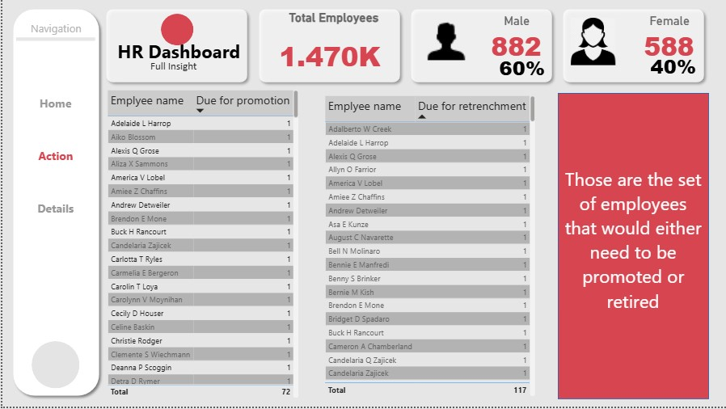
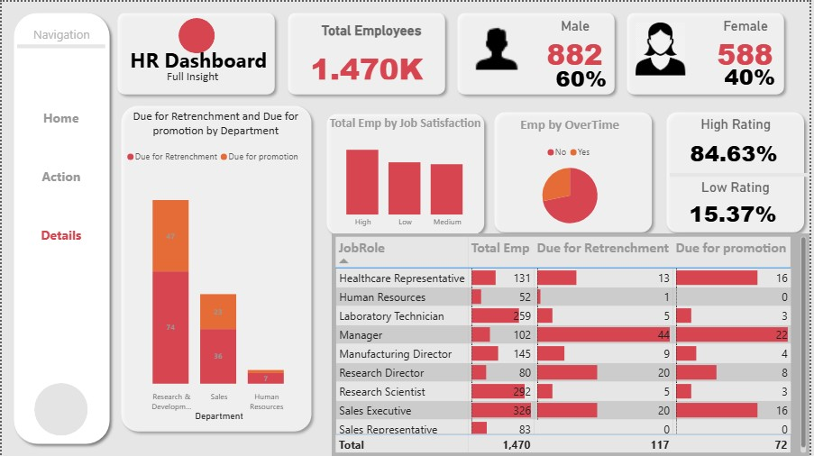

## 🖼️ Dashboard Preview

**Home**

**Action**

**Details**

## 📊 Key Metrics

| Metric | Value |
|---|---|
| Total Employees | 1,470 |
| Male / Female | 882 (60%) / 588 (40%) |
| Active Workers | 1,353 (92%) |
| Due for Promotion | 72 (4.9%) |
| Due for Retrenchment | 117 (8%) |

## 🔍 Key Insights

- **Promotion:** only 4.9% of employees are due for promotion, while 95.1% are not.
- **Retrenchment by department:** Research & Development has the most employees due for retrenchment (74), followed by Sales (36).
- **Job roles:** Managers have the most employees due for retrenchment (44) and promotion (22) in their role group. Sales Executive is the largest role, with 326 employees.
- **Ratings:** 84.63% of employees have a high rating and 15.37% a low rating.
- **Commute:** 63.95% of employees live very close to the office, and 15.58% live very far.

## 🧩 Dashboard Pages

1. **Home:** KPI cards, services year, job level view, distance from office, promotion status
2. **Action:** lists of employees due for promotion and for retrenchment
3. **Details:** department and job role breakdowns, job satisfaction, overtime and performance rating

## 🛠️ Tools Used

Microsoft Power BI

## 📬 Contact

[Olawumi matthew] – Olawumimatthew135@gmail.com 

